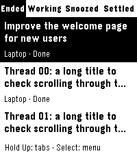

# T3 for Pebble

Read your T3 Code threads and reply from a Pebble Time 2. Buttons, saved replies, and system dictation. An independent, unofficial client, published by G-Cyrille under the MIT license.



[Install from the Pebble Appstore](https://apps.repebble.com/f09e2c791fbb4dd6a175e69b) · [Download 1.0.0](https://github.com/G-Cyrille/t3-pebble/releases/tag/v1.0.0)

English is the default. French is available in the Pebble app settings. [More translations are welcome](TRANSLATING.md).

## Connect

1. Run a T3 Code server with MCP and pairing-code support. Connect any other machines through T3's Connections screen.
2. Install T3 for Pebble, then open its settings in the Pebble mobile app.
3. Enter **your own T3 server address** and a fresh pairing code from T3 Connections. Choose permissions and connect.

One connection discovers threads on that server and its linked machines. Your phone must reach the server, using HTTPS or your own Tailscale VPN. There is no developer-hosted relay, account, or configuration website. The settings page is bundled with the app.

Read-only is the initial permission. Sending replies, requesting a summary, settling, or snoozing requires suitable T3 permissions. Full access can let agents act without approval; grant it only when intended. Changing permissions requires a new pairing code. Changing the language does not.

## Buttons

| Where | Button | Action |
| --- | --- | --- |
| Thread list | Up / Down | Select a thread; more rows load automatically |
| Thread list | Select | Read the thread |
| Any screen | Hold Up | Next category: Ended / Working / Snoozed / Settled |
| Thread list | Hold Select | Refresh all, settle, snooze, mark unread |
| Reader | Up / Down | Scroll; move between message pages at the ends |
| Reader | Select or hold Select | Actions and saved replies |
| Reply list | Up | Reach management actions above the first saved reply |
| Draft | Select | Send the displayed reply |
| Draft | Back | Cancel or return to the reply list |

The reply list starts on **3-line summary**. Other choices include dictation, continue, ask what the agent needs, use its recommendation, and wait for the computer. A summary sends a prompt to your agent and may use your provider credits. Every reply is shown as a draft before sending.

**Done means a completed reply unread on this watch. Finished means read.** This read state is stored by the phone companion and is independent of desktop T3 read state. Mark unread affects the watch only. The Ended category also contains idle, failed, and interrupted threads, with their own status labels.

## Refresh behavior

The phone fetches metadata for all threads on all linked machines, then builds a sorted snapshot for the four categories. Waiting threads come first, followed by running threads, then the most recently updated threads. No conversation contents are downloaded until you open a thread.

The list refreshes about every 60 seconds while open and idle. Updates apply after a two-second pause and preserve the selected thread when possible. Pagination starts two rows before the loaded end. Revision checks prevent mixing old and new pages, and the watch holds a moving window of at most 60 threads. Offline machines keep their previous rows, marked offline, until reachable again.

The reader checks for changes about every 20 seconds. It shows a notice; choose **Latest reply** to load the new text. **Refresh all** fetches metadata again for every category.

## Compatibility

- **Pebble Time 2 / emery** is the only packaged watch platform in 1.0.
- **Android** has been used on physical hardware. Release UI, pairing, pagination, and language changes are also checked in the Time 2 emulator.
- **iPhone reports are welcome.** Setup and dictation have not been validated on iOS. Please use the [iPhone compatibility issue form](https://github.com/G-Cyrille/t3-pebble/issues/new?template=iphone_compatibility.yml) with your iOS and Pebble app versions. Share both successes and failures.
- Dictation depends on the phone app, its configured service, and network access. It can be unavailable even when reading works. There is no app-specific speech service.
- T3 needs OAuth PKCE pairing and `t3_environment_read`, `t3_environment_links`, `t3_thread_list`, `t3_thread_read`, `t3_thread_send`, and `t3_thread_organize`. The integration was checked against the 0.1.8 nightly API of 2026-11-07. Nightly APIs can change; older or different versions may require updates.
- Accented Latin text is supported by the system fonts. Other scripts need font and layout validation. Existing conversations are never translated.

## Build and contribute

Install Node.js 22+, a C compiler for native model tests, Python 3, [Pebble Tool](https://developer.repebble.com/), and SDK 4.44.

```sh
npm ci
npm run check
npm run release
pebble install --emulator emery build/t3-pebble-v1.0.0.pbw
```

`pebble build` also regenerates translations and the embedded settings page. Release packaging removes SDK source maps containing local paths. [Development](docs/development.md), [contribution policy](CONTRIBUTING.md), [planned work](TODO.md), and [publication procedure](store/PUBLISHING.md).

AI-assisted issues and PRs are welcome. Disclose the agents and models used for writing and implementation. [Details and examples](CONTRIBUTING.md#ai-assisted-contributions).

[Privacy policy](https://g-cyrille.github.io/t3-pebble/privacy.html) · [Security reporting](SECURITY.md) · [Releases](https://github.com/G-Cyrille/t3-pebble/releases)

## En français

Lis les threads T3 et réponds depuis une Pebble Time 2. Dans les réglages de l'app Pebble, choisis Français puis enregistre la langue. La connexion existante reste enregistrée.

Renseigne l'adresse de **ton propre serveur T3** et un nouveau code depuis Connections. Une seule connexion suffit pour les machines liées. Le téléphone doit joindre le serveur, en HTTPS ou via ton VPN Tailscale. Aucun relais n'est hébergé par le développeur.

Un appui long sur Haut change de catégorie. Dans un thread, le bouton central ouvre les actions et les réponses, avec le résumé en trois lignes sélectionné par défaut. Remonte pour atteindre Rafraîchir, Settle, Snooze et Marquer non lu. Chaque réponse passe par un brouillon avant envoi.

Done signifie « terminé non lu sur la montre » ; Terminé signifie « lu ». Cet état n'est pas synchronisé avec celui du PC. Les retours iPhone sont bienvenus via le formulaire GitHub, y compris si tout fonctionne.
